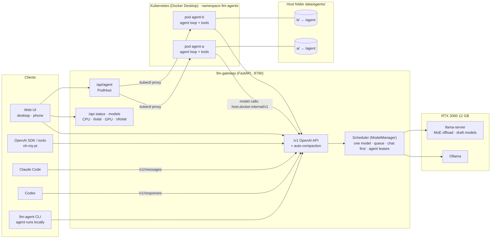

# llm-gateway

One OpenAI-compatible endpoint and a web UI for running local models on a single consumer GPU.
Point any OpenAI client at it, pick a model by id, and the gateway loads that model (unloading the previous one), keeps the conversation within the model's context, and streams the answer back.

Built and tuned on an RTX 3060 12 GB. The model list below was measured on that machine.

## Architecture



- **Model serving.**
  - Every client speaks the OpenAI API to `/v1`.
  - The ModelManager keeps exactly one model on the GPU, served by either Ollama or a tuned `llama-server`.
  - Requests that need the GPU wait in a queue (rules below), and agent tasks start one at a time.
- **Agents.**
  - Every web agent runs in its own Kubernetes pod.
  - The pod sees only its own host folder (`data/agents/<id>/`, mounted at `/agent`).
  - The pod calls the gateway's `/v1` for the model, like any other client.
  - The terminal agent (`llm-agent`) runs the same harness on this machine.
  - The code is explained in [docs/agent.md](docs/agent.md).

## Features

| | |
|---|---|
| **OpenAI-compatible API** | `/v1/models` and `/v1/chat/completions`, streaming included. Any OpenAI SDK or tool works. Set the base URL to the gateway and use a profile id as `model`. |
| **Claude Code and Codex** | Two more API formats, translated to the same models: the Anthropic Messages API (`/v1/messages`) for Claude Code, and the OpenAI Responses API (`/v1/responses`) for Codex. Both stream, including tool calls. See [Use with coding tools](#use-with-claude-code-codex-and-oh-my-pi). |
| **One model at a time** | A 12 GB card holds one model. Asking for a different model unloads the current one first, then loads the new one. Profiles with the same weights share one load: an 8K chat profile runs on the 32K agent profile of the same model without reloading. |
| **Scheduling** | Every model call (chat, agent, API, Claude Code, Codex) waits in one queue instead of failing:<br>1. **Same model:** shared, and chat goes before the agent's next call.<br>2. **Different model:** waits until the running agent task has finished. The task holds a lease on its model, so tool runs between its calls don't let anything switch the model.<br>3. **Agent tasks** start one at a time (`agent.max_running`). The others wait in line.<br><br>A lease is dropped after 10 minutes without a model call, and a request gives up after 30 minutes. The **Models** page and the **Resources** panel show the queue as one list. The running job comes first in a highlighted row (or *Empty* on a grey row), then every waiting job, one per row, in the order it will run. Details: [docs/agent.md](docs/agent.md#9-scheduling-two-layers). |
| **Auto-compaction** | When a conversation outgrows the model's context, the loaded model summarizes older messages (in the conversation's own language), and the summary is placed in the system prompt. The newest messages stay verbatim. Ollama would otherwise drop old messages silently, and llama.cpp would reject the request. |
| **Two backends** | **Ollama** for plain models. Requests go through its native `/api/chat` so each profile's context size applies. **llama.cpp** (`llama-server`) for tuned setups such as MoE expert offload (`-ncmoe`) or a draft model for speculative decoding. These setups make 20–35B models usable on 12 GB. |
| **Thinking switch** | `"think": false` turns reasoning off, or down to the lowest level for models that can't turn it off (gpt-oss, Muse). `true` turns it on. Answers can arrive much sooner with it off. |
| **Web UI (desktop + phone)** | **Models page:** every model with context, quantization, size, where it runs (GPU or GPU+CPU), measured speed, and collapsible details (file, parameters, launch flags). The page also shows which model is loaded. Every page, phone included, shows the computer's CPU, RAM, GPU load and VRAM.<br>**Chat page:** an Ollama-style chat over the same API, with conversations kept in the browser. Chats and agent tasks can be renamed in the ☰ list (✎).<br>**API page:** copyable examples. Installable as a home-screen app. |
| **Coding agent** | A Claude Code-style agent harness on the local models, available in the web UI (Agent tab) and as a terminal command (`llm-agent`).<br>**Tools:** files (read, write, edit, glob, grep), `bash`, `git`, `web_fetch` and a task list.<br>**Behaviour:** permission modes with approval prompts; skills (`SKILL.md`), hooks and MCP servers; memory in `AGENTS.md`; context compaction; sessions saved after every step. See [docs/agent.md](docs/agent.md) for a guided tour of the code. |
| **Clean GPU** | On Windows, the `llama-server` processes the gateway starts are killed with it, even if the gateway itself is killed. The gateway never unloads pinned Ollama models, e.g. an embedding model another service uses. |

## Models (RTX 3060 12 GB)

All speeds are generation speed in tokens/s, measured through the gateway with `scripts/measure.py`. "Chinese" is a Chinese chat prompt; "English" is an English coding prompt. Speculative decoding helps the two prompts differently, so both are listed. The goal was ≥ 30 tok/s.

| Profile id | Model | Backend | Quant (avg bits) | Context | Runs on | Chinese | English |
|---|---|---|---|---|---|---:|---:|
| `gemma4-12b-qat-mtp` | Gemma 4 12B QAT + MTP draft | Ollama | Q4_0 QAT (4.69) | 8K | GPU | 46.1 | **74.4** |
| `gemma4-12b` | Gemma 4 12B + MTP draft | Ollama | Q4_K_M (4.96) | 4K | GPU | 49.7 | 72.9 |
| `llama3.1-8b` | Llama 3.1 8B | Ollama | Q4_K_M (4.9) | 8K | GPU | **61.8** | 62.4 |
| `qwen3-8b` | Qwen3 8B | Ollama | Q4_K_M (5.1) | 8K | GPU | 58.5 | 58.4 |
| `qwen3.5-9b` | Qwen3.5 9B | Ollama | Q4_K_M (5.03) | 8K | GPU | 50.0 | 49.9 |
| `gpt-oss-20b-moe` | gpt-oss 20B | llama.cpp | MXFP4 (5.28) | 8K | GPU+CPU (2 expert layers on CPU) | 48.9 | 48.9 |
| `qwen3-14b-draft` | Qwen3 14B + Qwen3 0.6B draft | llama.cpp | Q4_K_M (5.02) | 8K | GPU | 24.6 | 47.2 |
| `gpt-oss-20b` | gpt-oss 20B | Ollama | MXFP4 (5.28) | 8K | GPU+CPU (~25% on CPU) | 45.4 | 45.2 |
| `gemma4-26b-qat-moe` | Gemma 4 26B-A4B QAT | llama.cpp | Q4_0 QAT (4.58) | 8K | GPU+CPU (11 expert layers on CPU) | 45.1 | 45.0 |
| `mistral-nemo-12b` | Mistral Nemo 12B | Ollama | Q4_0 (4.62) | 8K | GPU | 44.8 | 44.7 |
| `qwen3-14b` | Qwen3 14B | Ollama | Q4_K_M (5.02) | 8K | GPU | 34.0 | 33.9 |
| `qwen3.6-35b-moe` | Qwen3.6 35B-A3B | llama.cpp | Q4_K_M (4.89) | 8K | GPU+CPU (28 expert layers on CPU) | 30.5 | 20.1 |
| `muse-glimmer-iq2` | Muse Glimmer 30B | llama.cpp | UD-IQ2_XXS (3.09) | 8K | GPU | 22.0 | 22.1 |

**Agent profiles** (`"tools": true`) use the same weights with a 32K context, because agents fill the context fast with file contents and command output:

| Profile id | Runs on | Chinese | English |
|---|---|---:|---:|
| `qwen3-8b-agent` | GPU | 58.3 | 58.3 |
| `qwen3.5-9b-agent` | GPU | 49.8 | 50.3 |
| `gemma4-26b-agent` | GPU+CPU (14 expert layers on CPU, KV q8_0) | 24.0 | 32.4 |
| `qwen3.6-35b-agent` | GPU+CPU (30 expert layers on CPU, KV q8_0) | 13.6 | 14.0 |
| `qwen3.5-9b-code` (64K, for Claude Code / Codex) | GPU (7.1 GB) | 50.9 | 51.2 |

The two MoE agent profiles were measured with only ~1 GB of system RAM free; they depend heavily on free RAM. In an end-to-end test, `qwen3-8b-agent` found a bug in a small project, fixed it and ran pytest until it passed in 21 s. gpt-oss is not offered for the agent: through llama.cpp its tool calls were not parsed.

- **Which to use:**
  - **Best quality that stays above 30 tok/s:** `gemma4-26b-qat-moe`.
  - **Strongest model:** `qwen3.6-35b-moe`, but slower for code.
  - **Fastest:** the Gemma 4 12B profiles for English/code, `llama3.1-8b` and `qwen3-8b` for Chinese.
- **Model sources:**
  - Ollama profiles use the Ollama tag shown in the UI.
  - The llama.cpp profiles load GGUF files directly. Most are the blobs of the Ollama tags `gemma4:26b-a4b-it-qat`, `gpt-oss:20b`, `qwen3.6:35b-a3b`, `qwen3:14b` and `qwen3:0.6b`. Muse is an Unsloth UD-IQ2_XXS GGUF.
  - `gemma4-12b-qat-mtp` is a local Ollama model: Gemma 4 12B QAT weights plus Gemma's MTP draft model.
- **Avg bits** = file size × 8 ÷ parameters. It includes parts kept at higher precision, such as embeddings, so it is above the format's nominal bits.
- **Muse** is 2-bit, about 11% worse perplexity than 4-bit, so that a 30B dense model fits the card. It thinks at length by default, so send `"think": false` for faster answers.

### Test machine

| | |
|---|---|
| GPU | NVIDIA GeForce RTX 3060, 12 GB, driver 591.59 |
| CPU | Intel Core i5-11400 (6 cores) |
| RAM | 32 GB |
| Disk | Models on a HDD. Loading a model takes from seconds (if the file is still in the OS file cache) to a few minutes. Speeds above are after loading. |
| OS | Windows 11 |
| Software | Ollama 0.34.2, llama.cpp build 11756 (CUDA), Python 3.12 via uv |

### Conditions that change the numbers

- **Free GPU memory.** The desktop, browsers and other apps use GPU memory too. In the measurements, about 0.6 GB was also taken by a pinned embedding model (`bge-m3`). A model that no longer fits spills into shared system memory and gets 5–10x slower without any error. Close GPU-heavy apps if a model suddenly crawls.
- **Free system RAM** matters for GPU+CPU models. `qwen3.6-35b-moe` keeps ~14 GB of experts in RAM; with less free RAM it slows down.
- **Context size.** Each profile's context was tuned to fit. A larger context needs more GPU memory, so MoE profiles need more expert layers on the CPU (re-tune `-ncmoe`), and dense models may spill.
- **Language and content.** Draft-model speculative decoding is fast when the draft guesses well, as with English code, and can be slower than no draft for Chinese.
- **Thinking.** Speeds are tokens/s, but thinking models also spend tokens on reasoning before answering. With `max_tokens` set low, a thinking model can use them all on reasoning and return an empty answer.

## Quick start

Requires [uv](https://docs.astral.sh/uv/), [Ollama](https://ollama.com) for Ollama profiles, and a CUDA build of [llama.cpp](https://github.com/ggml-org/llama.cpp/releases) `llama-server` for llama.cpp profiles.

```bash
cp .env.example .env                 # machine-specific values: model folders, binaries, API key
cp config.example.json config.json   # profiles; refers to .env values as ${NAME}
uv run llm-gateway                   # or: uv run llm-gateway --config path/to/config.json
```

Open `http://127.0.0.1:8790`. To use it from a phone, set `server.host` to `0.0.0.0` and open `http://<pc-address>:8790` over your LAN or a VPN such as Tailscale. Allow the port in the firewall, and set an `api_key` if the network isn't yours alone.

## API

| Method | Path | |
|---|---|---|
| GET | `/v1/models` | Profiles, with `context_length` and `active`. |
| POST | `/v1/chat/completions` | OpenAI chat completions; `stream: true` supported. Switches model if needed; 409 if another model is in use. Extra field `think` (bool). |
| POST | `/v1/messages` | Anthropic Messages API (Claude Code). Busy model → 529, which Claude Code retries. |
| POST | `/v1/messages/count_tokens` | Estimated prompt tokens, for Claude Code's context meter. |
| POST | `/v1/responses` | OpenAI Responses API (Codex). Stateless: send the full input (`previous_response_id` is not supported). |
| GET | `/api/status` | Active model, state (`idle` / `loading` / `ready` / `error`), whether it is busy, and resources: CPU %, RAM, GPU load and VRAM. |
| GET | `/api/profiles` | Full profile list for the UI. |
| POST | `/api/activate` | `{"id": "..."}`: load a model ahead of time. Waits its turn in the queue. |
| POST | `/api/unload` | Release the GPU. Waits for running requests and agent tasks. |
| DELETE | `/v1/leases/{id}` | An agent task ended; its model may be switched again. Sent by the agent harness. |
| GET | `/api/health` | Liveness, no auth. |

```python
from openai import OpenAI
client = OpenAI(base_url="http://127.0.0.1:8790/v1", api_key="none")
r = client.chat.completions.create(
    model="gemma4-26b-qat-moe",
    messages=[{"role": "user", "content": "Hello"}],
    extra_body={"think": False},
)
print(r.choices[0].message.content)
```

The agent has its own routes under `/api/agent/` for the web UI:

- `info`, `sessions` (create, get, update mode/model, delete)
- `sessions/{id}/turn` and `sessions/{id}/events` (SSE)
- `sessions/{id}/permission` and `sessions/{id}/cancel`

With `agent.sandbox: "k8s"` they answer any device, because every agent is shut in its own pod. With `local`, other devices need `server.api_key`.

When a conversation was compacted, the response says so. Non-streaming responses carry the header `X-LLM-Gateway-Compacted` and an `llm_gateway` field. Streaming responses start with the SSE comment line `: llm-gateway {...}`. Reasoning is returned in `reasoning_content`.

## Use with Claude Code, Codex and oh-my-pi

These tools work through the gateway on local models. Their system prompts and tool definitions are large: about 20K tokens for Claude Code and 13K for Codex. So they need a profile with a big context, such as `qwen3.5-9b-code` (64K, fully on the GPU).

Tested on the RTX 3060 with a small project with a failing test. Each tool found both bugs, fixed them, and ran pytest until it passed:

| Tool | Model | Time |
|---|---|---|
| Claude Code 2.1.296 | `qwen3.5-9b-code` | 61 s |
| Codex | `qwen3.5-9b-code` | 50 s |

With a 32K profile, Claude Code ran out of room ("Autocompact is thrashing") and left the fix half done.

**Claude Code** (environment variables):

```bash
ANTHROPIC_BASE_URL=http://127.0.0.1:8790
ANTHROPIC_AUTH_TOKEN=local                 # anything; or your server.api_key
ANTHROPIC_MODEL=qwen3.5-9b-code
ANTHROPIC_DEFAULT_HAIKU_MODEL=qwen3.5-9b-code   # side requests (titles, summaries) use the same model
CLAUDE_CODE_MAX_CONTEXT_TOKENS=65536       # the real window, so Claude Code compacts in time
CLAUDE_CODE_MAX_OUTPUT_TOKENS=8192
CLAUDE_CODE_ATTRIBUTION_HEADER=0           # keeps the prompt prefix stable, so the model can reuse its cache
```

Notes:

- Anthropic does not support Claude Code on non-Claude models; it works, but expect a much weaker model than Claude.
- An unknown model name in a request (Claude Code's own names) is served by the model already loaded, so side requests never force a model switch.

**Codex** (`~/.codex/config.toml`):

```toml
model = "qwen3.5-9b-code"
model_provider = "llmgw"
model_context_window = 65536
model_max_output_tokens = 8192

[model_providers.llmgw]
name = "llm-gateway"
base_url = "http://127.0.0.1:8790/v1"
wire_api = "responses"
```

Note on Windows: Codex's own sandbox blocked every command in `--sandbox workspace-write` during the test. With `--sandbox danger-full-access` (in a folder you don't mind it changing) it worked.

**oh-my-pi** (`~/.omp/agent/models.yml`) uses plain Chat Completions:

```yaml
providers:
  llm-gateway:
    baseUrl: http://127.0.0.1:8790/v1
    api: openai-completions
    auth: none
    compat: {supportsDeveloperRole: false, supportsReasoningEffort: false}
    models:
      - {id: qwen3.5-9b-code, contextWindow: 65536}
```

## Configuration (`.env` and `config.json`)

Values that belong to this machine live in **`.env`**: model folders, binaries, the project folder, the Kubernetes context, and the API key. `.env` is not committed; **`.env.example`** lists every variable.

`config.json` refers to them as `${NAME}` or `${NAME:-default}`, for example `"server_binary": "${LLAMA_SERVER}"`. Real environment variables win over `.env`. A missing variable without a default stops the gateway with a message naming it.

### `config.json`

`config.json` is machine-specific (model paths) and git-ignored; `config.example.json` is the template.

| Key | Meaning |
|---|---|
| `server.host` / `server.port` | Bind address. `127.0.0.1` = this machine only; `0.0.0.0` = reachable from your LAN / Tailscale (e.g. a phone). |
| `server.auto_compact` | Summarize older messages when a conversation outgrows the context (default `true`). |
| `server.api_key` | If set, every `/api` and `/v1` call needs `Authorization: Bearer <key>`; the UI asks for it on the API page. Set one before exposing the gateway beyond your own machine. |
| `ollama.url` | Ollama server. |
| `ollama.pinned` | Ollama models that are never unloaded when switching (e.g. an embedding model another service depends on). |
| `llamacpp.server_binary` | Path to `llama-server`. |
| `llamacpp.port` | Port for the managed `llama-server` (local only). |
| `llamacpp.startup_timeout_s` | How long to wait for a model to load. |
| `llamacpp.log_dir` | `llama-server` logs, one file per profile (relative to the config file). |

| `agent.workspaces` | Folders the agent may work in from the web UI (the CLI works in any folder you start it in). |
| `agent.default_workspace` | Where new web tasks start: an empty folder (default `data/workspace`). The folder can be changed any time in the UI. |
| `agent.sandbox` | `local`: agents run in the gateway and act on this computer. `k8s`: each agent runs in its own Kubernetes pod and can only touch its own folder ([details](docs/agent.md#pods-agentsandbox-k8s)). |
| `agent.k8s.agents_dir` | Host folder for pod agents; agent `<id>` gets `<agents_dir>/<id>/` mounted at `/agent` (default `data/agents`). |
| `agent.k8s.*` | `namespace`, `image`, `kube_context`, `cpu` / `memory` limits per pod, `gateway_url` (how pods reach the gateway), `host_mount_prefix`. |
| `agent.data_dir` | Saved agent sessions, plus user-wide `AGENTS.md` and `skills/` (default `data`). |
| `agent.default_mode` | `plan`, `default`, `accept_edits` or `bypass` (see [docs/agent.md](docs/agent.md#6-safety-model)). |
| `agent.max_steps` | Model calls per agent turn before it stops and asks you to continue. |
| `agent.max_running` | Agent tasks running at the same time (default 1). The GPU generates for one request at a time, so more is rarely faster. |
| `agent.hooks`, `agent.mcp_servers` | Shell hooks and MCP servers for the agent ([examples](docs/agent.md#7-extending-it)). |

Each entry in `profiles`:

| Field | Required | Meaning |
|---|---|---|
| `id` | yes | Used as `model` in API calls. |
| `name` | yes | Display name. |
| `backend` | yes | `ollama` or `llamacpp`. |
| `context` | yes | Context window to load the model with (tokens). |
| `model` | ollama | Ollama tag, e.g. `qwen3:8b`. |
| `model_path` | llamacpp | GGUF file. |
| `args` | no | Extra `llama-server` flags (llamacpp only), e.g. `["-ngl","99","-ncmoe","12"]`. |
| `tools` | no | `true` if the model calls tools reliably; only these can be picked for the agent. |
| `placement` | no | `gpu` or `gpu+cpu`, shown as a tag in the UI. Check with `ollama ps` (Ollama) or the `-ncmoe` flag (llama.cpp). |
| `max_context`, `type`, `size_gb`, `notes` | no | Shown in the UI. |
| `quant`, `bits`, `params_b` | no | Quantization format, average bits per weight and parameter count, shown in the UI. |
| `speed_tps`, `speed_zh_tps` | no | Measured generation speed (tok/s) on an English coding prompt and a Chinese chat prompt. Fill them with `scripts/measure.py --write config.json`. |

## Scripts

| Script | |
|---|---|
| `uv run llm-agent [--model id] [--mode m] [-p "task"]` | The coding agent in the terminal, working in the current folder (the gateway must be running). `--resume <id>` continues a saved session; `/help` lists commands. |
| `uv run python scripts/measure.py --write config.json [ids...]` | Measure each profile through the running gateway (English code + Chinese chat) and store the speeds in the config. |
| `uv run python scripts/smoke_test.py [base] <id> [other-id]` | End-to-end check: plain and streaming chat, then switch to another model and back. |
| `uv run --with pillow python scripts/make_icons.py` | Regenerate the app icons in `llm_gateway/static/icons/`. |

## Troubleshooting

- **A model is suddenly several times slower.** Something else is holding GPU memory and the model spilled into shared memory. Check `nvidia-smi` for leftover `llama-server` processes or GPU-heavy apps. The gateway refuses to start a llama.cpp model while its port is still held by an old `llama-server`, and says so.
- **Empty answer.** A thinking model spent `max_tokens` on reasoning. Raise `max_tokens` or send `"think": false`.
- **Ollama fails to load a model with a draft (MTP).** There isn't enough free GPU memory for the draft model; lower the profile's `context`.

## Development

```bash
uv run --group dev pytest
```
