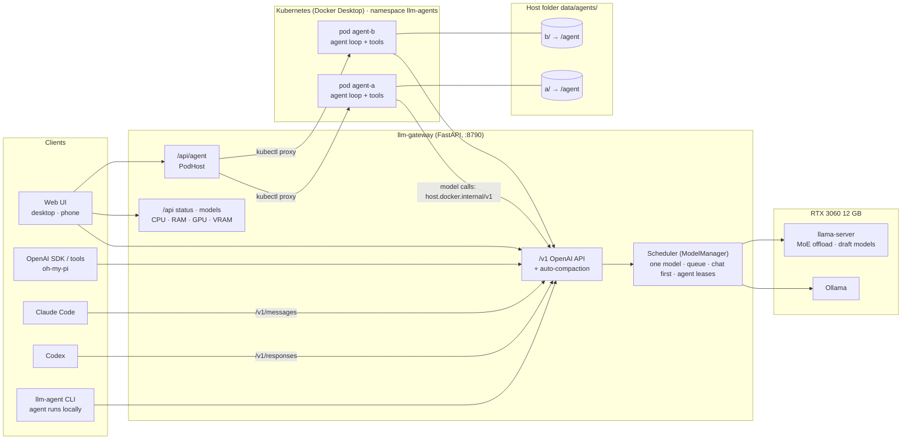

# llm-gateway

Run local models on one consumer GPU behind a single API, with a web UI, a coding agent, and
support for Claude Code and Codex. Built and measured on an RTX 3060 12 GB.

## Architecture



## What it does

| | |
|---|---|
| **One endpoint, many clients** | OpenAI Chat Completions (`/v1/chat/completions`), Anthropic Messages (`/v1/messages`, for Claude Code) and OpenAI Responses (`/v1/responses`, for Codex), all streaming with tool calls. |
| **One GPU, scheduled** | One model is loaded at a time, and every call waits in one queue instead of failing:<br>1. **Same model:** shared, and chat goes first.<br>2. **Different model:** waits until the running agent task finishes.<br>3. **Agent tasks:** one runs at a time.<br><br>Profiles with the same weights share one load. [How it works](docs/agent.md#9-scheduling-two-layers). |
| **Coding agent** | A Claude Code-style harness: files, `bash`, `git`, web, a task list; permission modes, skills, hooks, MCP; compaction; sessions saved after every step. Each web agent runs in its own Kubernetes pod; `llm-agent` runs it in a terminal. [Code tour](docs/agent.md). |
| **Web UI (desktop + phone)** | Chat, Agent, API and Models pages; CPU / RAM / GPU / VRAM, and the GPU queue under **Resources** on the Models page; rename chats and tasks; installable as a home-screen app. |
| **Fits long chats** | When a conversation outgrows the context, older messages are summarized in its own language. |
| **Fast on 12 GB** | Tuned llama.cpp setups (MoE expert offload, draft models) next to plain Ollama models. |

## Quick start

Needs [uv](https://docs.astral.sh/uv/), [Ollama](https://ollama.com), and a CUDA build of [llama.cpp](https://github.com/ggml-org/llama.cpp/releases) for llama.cpp profiles.

```bash
cp .env.example .env                 # this machine: model folders, binaries, API key
cp config.example.json config.json   # model profiles; refers to .env as ${NAME}
uv run llm-gateway                   # then open http://127.0.0.1:8790
```

### Run with Docker

To run the gateway as a background container with automatic restart (`unless-stopped`):

```bash
docker compose up -d
```
Access the gateway on `http://127.0.0.1:8790`. It communicates with host Ollama via `http://host.docker.internal:11434`.

Phone: set `GATEWAY_HOST=0.0.0.0` and open `http://<pc-address>:8790` over your LAN or Tailscale.
Agent pods: enable Kubernetes in Docker Desktop and build the image
(`docker build -f deploy/agent.Dockerfile -t llm-gateway-agent:latest .`).
All settings: [docs/configuration.md](docs/configuration.md).

## Models (RTX 3060 12 GB)

Speeds are tokens/s through the gateway (`scripts/measure.py`) on a Chinese chat prompt and an English
coding prompt. **Agent** = offered in the Agent menu (see below).

| Model | Context | Runs on | Chinese | English | Agent |
|---|---|---|---:|---:|:---:|
| Gemma 4 12B QAT + MTP | 8K | GPU | 46.1 | **74.4** | — |
| Gemma 4 12B (MTP) | 4K | GPU | 49.7 | 72.9 | — |
| Gemma 4 12B QAT | 32K | GPU | 40.4 | 40.4 | ✓ |
| Gemma 4 26B-A4B QAT | 8K / 32K | GPU+CPU | 45.1 / 24.0 | 45.0 / 32.4 | not evaluated |
| gpt-oss 20B (Ollama / llama.cpp) | 8K | GPU+CPU | 45–49 | 45–49 | — |
| Llama 3.1 8B | 8K / 32K | GPU | **61.8** | 62.4 | — |
| Mistral Nemo 12B | 8K / 32K | GPU | 44.8 | 44.7 | — |
| Muse Glimmer 30B (2-bit) | 8K | GPU | 22.0 | 22.1 | — |
| Qwen3 8B | 8K / 32K | GPU | 58.5 | 58.4 | ✓ (32K) |
| Qwen3 14B (/ + 0.6B draft) | 8K | GPU | 34.0 / 24.6 | 33.9 / 47.2 | — |
| Qwen3.5 9B | 8K / 32K / 64K | GPU | 50.0 | 49.9 | ✓ (32K, 64K) |
| Qwen3.6 35B-A3B | 8K / 32K | GPU+CPU | 30.5 / 13.6 | 20.1 / 14.0 | not evaluated |

Where profiles share weights, the 8K one is for fast chat and the larger one for agents (64K for
Claude Code / Codex). Larger contexts cost speed only on GPU+CPU models, whose extra context pushes
more expert layers to the CPU. Per-profile details (quantization, launch flags) are on the Models page.

### How agent models are chosen

A model goes into the Agent menu if it succeeds in **at least 60%** of a real-task evaluation: 6
coding tasks × 3 runs, each run checked automatically.

| Model | Result |
|---|---|
| Gemma 4 12B QAT | 78% |
| Qwen3.5 9B | 72% |
| Qwen3 8B | 61% |
| Llama 3.1 8B | 6% |
| Mistral Nemo 12B | 6% |

The tasks, per-task results and method are in [docs/agent-eval.md](docs/agent-eval.md). Even the best
small local model fails some tasks, so check its work.

### Why some models are chat-only

- **Below 60% in the evaluation:** Llama 3.1 8B (broken tool calls), Mistral Nemo 12B (answers without doing the task).
- **Tool calls not usable:** gpt-oss through llama.cpp returns its tool calls as text the server does not parse.
- **No room for an agent's context:** Gemma 4 12B with the MTP draft model and Muse 30B do not fit 32K on 12 GB. The draft-free Gemma 4 12B QAT (32K) is the agent version.
- **Not evaluated yet:** Gemma 4 26B and Qwen3.6 35B keep experts in system RAM (up to ~14 GB), and the run was stopped for lack of memory. Run `scripts/agent_eval.py --models gemma4-26b-agent qwen3.6-35b-agent` with RAM free.

## Use with Claude Code, Codex and oh-my-pi

Their prompts and tool definitions alone are ~20K (Claude Code) and ~13K (Codex) tokens, so use the
64K profile `qwen3.5-9b-code`. Tested: each fixed a failing test project end to end (Claude Code
2.1.296 in 61 s, Codex in 50 s). Anthropic does not support Claude Code on non-Claude models; it works,
but the model is far weaker than Claude.

```bash
# Claude Code
ANTHROPIC_BASE_URL=http://127.0.0.1:8790
ANTHROPIC_AUTH_TOKEN=local
ANTHROPIC_MODEL=qwen3.5-9b-code
ANTHROPIC_DEFAULT_HAIKU_MODEL=qwen3.5-9b-code
CLAUDE_CODE_MAX_CONTEXT_TOKENS=65536
CLAUDE_CODE_MAX_OUTPUT_TOKENS=8192
CLAUDE_CODE_ATTRIBUTION_HEADER=0
```

```toml
# Codex: ~/.codex/config.toml   (on Windows its own sandbox blocked commands; --sandbox danger-full-access worked)
model = "qwen3.5-9b-code"
model_provider = "llmgw"
model_context_window = 65536
[model_providers.llmgw]
name = "llm-gateway"
base_url = "http://127.0.0.1:8790/v1"
wire_api = "responses"
```

```yaml
# oh-my-pi: ~/.omp/agent/models.yml
providers:
  llm-gateway:
    baseUrl: http://127.0.0.1:8790/v1
    api: openai-completions
    auth: none
    compat: {supportsDeveloperRole: false, supportsReasoningEffort: false}
    models: [{id: qwen3.5-9b-code, contextWindow: 65536}]
```

## API

| Method | Path | |
|---|---|---|
| GET | `/v1/models` | Profiles with `context_length` and `active` |
| POST | `/v1/chat/completions` | OpenAI chat (stream, tools; extra field `think`) |
| POST | `/v1/messages`, `/v1/messages/count_tokens` | Anthropic Messages (Claude Code) |
| POST | `/v1/responses` | OpenAI Responses (Codex), stateless |
| GET | `/api/status` | Loaded model, GPU queue, CPU / RAM / GPU / VRAM |
| POST | `/api/activate`, `/api/unload` | Load a model ahead of time / release the GPU (both wait their turn; `/api/unload?force=true` releases now and clears leftovers, as the UI's Release button does) |
| POST | `/v1/async/chat/completions` | Background job: returns a `job_id` at once; poll `GET /v1/jobs/{id}`. Priorities, retries, dead letters, stats: [docs/async-jobs.md](docs/async-jobs.md) |
| | `/api/agent/...` | Agent sessions for the web UI ([docs/agent.md](docs/agent.md)) |

Requests wait in the GPU queue instead of failing. A request gives up after 30 minutes. Set
`server.api_key` before exposing the gateway beyond your own machine.

## Scripts

| | |
|---|---|
| `uv run llm-agent` | The coding agent in a terminal (current folder; `-p "task"`, `--resume <id>`, `/help`) |
| `uv run python scripts/measure.py --write config.json [ids]` | Measure speeds and store them in the config |
| `uv run --group dev python scripts/agent_eval.py --models <ids>` | Evaluate models as agents (6 tasks × 3 runs) |
| `uv run python scripts/smoke_test.py [base] <id>` | Quick end-to-end check |
| `uv run --group dev pytest` | Tests |

## License

[MIT](LICENSE).

## Built with AI Agents

- **Claude Code**
- **Antigravity**
- **Codex**
