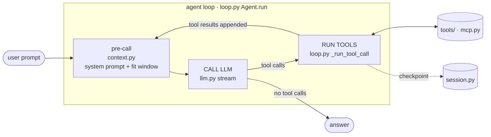
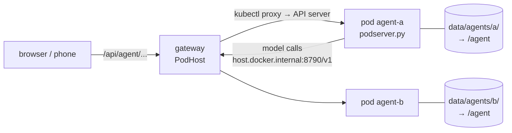

# The agent harness: a reading guide

`llm_gateway/agent/` is a small coding agent in the style of Claude Code: you give it a task, and
it reads and searches files, edits code, runs commands and git, and loops until it is done. It
runs on the local models served by the gateway. About 2,000 lines including docstrings, written
to be read.

This guide maps the code to the usual agent architecture diagram, lists the design patterns it
uses and why, and points at the file and function for each idea.

## 1. One loop, two states

Diagrams of agents show many boxes: Planner, Reasoning, Thinking / Action / Action Input,
Reflection, Tool, MCP, Memory. In code they collapse into **one loop with two states**:



| Box in the diagram | Where it lives | What it really is |
|---|---|---|
| Planner | `tools/todo.py` + the model | The model writes a task list with the `todo_write` tool; it is put back into the system prompt on every call |
| Reasoning, Thinking / Action / Action Input | one model call (`llm.py`) | One response: some text plus `tool_calls` (name + arguments) |
| Reflection | the *next* model call | It sees the tool results, including errors, and decides again |
| Tool | `tools/*.py` | Classes with a schema, a risk level and `run()` |
| MCP | `mcp.py` | A transport: remote tools adapted into the same `Tool` interface |
| Memory | `context.py`, `session.py` | Before each call: build the context. After each step: save the session |

Control changes hands at exactly two points: the model hands control over by emitting
`tool_calls`, and gets it back when the tool results are appended to the messages.

## 2. Follow one request through the code

`llm-agent -p "what version is in pyproject.toml?"`

1. `cli.py main()` loads `config.json` and builds an agent with `AgentRuntime.agent()` (`runtime.py`).
2. `Agent.run(prompt)` (`loop.py`) runs the `UserPromptSubmit` hook and appends the user message.
3. **Pre-call.** `build_system_prompt()` (`context.py`) assembles:
   - the rules,
   - the environment (workspace, OS, shell, git branch),
   - `AGENTS.md`,
   - the skills index,
   - the task list.

   `ContextManager.fit()` then shrinks the history if it would not fit the window.
4. **Call LLM.** `LLMClient.stream()` (`llm.py`) POSTs to the gateway's `/v1/chat/completions`
   with the tool schemas. Text is yielded as `TextDelta` events; tool-call fragments are assembled
   by `index`.
5. The model answers with `tool_calls=[read_file({"path": "pyproject.toml"})]`.
6. **Run tools.** `_run_tool_call()` goes through six gates, in order:
   1. parse and validate the arguments: `parse_arguments`, `validate` (`tools/base.py`)
   2. loop detector, then circuit breaker (`errors.py`)
   3. permission: `PermissionPolicy.decide()`, and if needed `Approver.ask()` (`permissions.py`)
   4. the `PreToolUse` hook (`hooks.py`)
   5. execute, retrying transient errors with backoff: `retry_transient` (`errors.py`)
   6. post-tool checks: the silent-failure hint, then the `PostToolUse` hook
7. The result is appended as a `tool` message, and the session is saved (`SessionStore.save`).
8. Back to step 3. The model now sees the file and answers in plain text: no tool calls, so the
   `Stop` hook runs and the turn ends with `TurnEnd("done")`.

## 3. Design patterns used, and why

| Pattern | Where | Why it is used here |
|---|---|---|
| **ReAct loop** (reason → act → observe) | `loop.py` | The standard agent core ([ReAct paper](https://arxiv.org/abs/2210.03629)). The "observe" step is the tool result going back into the messages |
| **Command** | `tools/base.py` `Tool` | Each tool is an object with `schema()` + `run()`. The loop calls tools without knowing what they do |
| **Registry** | `ToolRegistry` | Tools are looked up by name; adding a tool means registering one class |
| **Adapter** | `mcp.py` `MCPTool`, `errors.py` `ToolError` | Remote MCP tools look like local ones. Every failure is translated into one error shape (`code`, `message`, `retryable`, `side_effect`) |
| **Strategy** | `permissions.py` `Approver` | "How to ask the user" differs per UI (terminal prompt vs. web button); the loop only calls `ask()` |
| **Observer / event stream** | `events.py` | The loop yields events and never prints. CLI and web render the same stream |
| **Async generator as a coroutine** | `Agent.run()` | The turn is a lazy stream. The caller can stop it at any `await` (Ctrl+C, the stop button) |
| **Factory** | `runtime.py` `AgentRuntime` | One place assembles tools, skills, memory and MCP, so both UIs get the same agent |
| **Template-method hooks** | `hooks.py` | Fixed lifecycle points (before and after tool use, on stop) run your own scripts deterministically |
| **Circuit breaker** | `errors.py` | A tool that fails 3 times in a row is switched off for the session |
| **Retry with exponential backoff + jitter** | `errors.py` `retry_transient` | Only for errors marked `retryable`, never for ones with side effects ([AWS write-up](https://aws.amazon.com/builders-library/timeouts-retries-and-backoff-with-jitter/)) |
| **Checkpoint / memento** | `session.py` | The whole state is plain data, written atomically after every step, so any session can be resumed |
| **Progressive disclosure** | `skills.py` | Only skill names and descriptions sit in the prompt; the full text loads on demand |
| **Human-in-the-loop** | permission modes | Risky actions wait for a person ([Anthropic: Building effective agents](https://www.anthropic.com/engineering/building-effective-agents)) |

## 4. Failure handling: classify first, then route

The deciding question is "would retrying 100 times help?" (`errors.py` `classify`):

| Kind | Example | Handled by |
|---|---|---|
| model_error | Arguments are broken JSON; unknown tool | Error + tool schema sent back; the model fixes the call |
| invalid_args | Missing field, wrong type | Same, with every problem listed at once |
| transient | Timeout, 502, connection reset | Retried in `retry_transient` (0.5 s, 1 s, … + jitter) |
| side_effect | A command timed out halfway | Never retried. The model is told to check the current state first |
| silent | `grep` found nothing | Not an error; a hint asks the model to check the pattern before concluding |

These guards wrap the whole loop:

- **Announced but not done** (`errors.announces_unfinished_work`). Small models often end with
  "Let me fix this now." and no tool call. The loop answers "Go ahead", at most twice per turn.
  It does not when the reply asks the user a question.
- **Failed, not broken.** A command that runs but exits non-zero returns `ToolOutput(text, ok=False)`.
  The model sees the output, the UI shows ✗, and the circuit breaker does not count it.
- **Timeouts.** `bash` takes a `timeout` of up to 30 minutes. Network git commands get 15 minutes.
  A timed-out command reports that it may have left a `.git/*.lock` file behind.
- **Step budget** (`max_steps`).
- **Loop detector.** A repeated identical call gets a warning; the third one stops the turn.
- **Circuit breaker.**
- **Checkpoint after every step.**

## 5. Context engineering (`context.py`)

The context window is the agent's working memory, and small local models have small ones
(32K in the agent profiles). Before every call:

- **System prompt, rebuilt each time**:
  - rules, and plan-mode rules when in plan mode
  - the environment
  - long-term memory: `AGENTS.md` / `CLAUDE.md` from the workspace and from `data/`
  - the skills index
  - working memory: the task list and the summary of compacted steps
- **Stage 1 (cheap):** when the history passes 75% of the window, old tool results are replaced
  with a short placeholder. The model can always re-read a file.
- **Stage 2:** if it still does not fit, older messages are summarized by the model and replaced
  by the summary.
  - Cuts happen only in front of a user or assistant message, so a tool call is never separated
    from its result.
  - Tested in `test_context_clears_old_results_then_summarizes_on_step_boundaries`.
- **Tool output is truncated** (head + tail) to a size derived from the context window.
- **Prompt-injection defence.** Web pages come back inside `<untrusted_content>` tags, and the
  rules say never to follow instructions found there.

## 6. Safety model

| Layer | What it stops |
|---|---|
| **Workspace jail.** `ToolContext.resolve()` checks every path after resolving it | `../../`, absolute paths, symlink tricks in file tools |
| **Permission modes** (`permissions.py`) | Writes and commands without your approval. The mode can change mid-turn |
| **Dynamic risk.** `Git.risk_for()` | `git status` runs freely; `commit` asks; `push` / `reset --hard` are `exec` even in `accept_edits` |
| **Read-before-write** (`tools/files.py`) | Overwriting a file the model has not seen |
| **One pod per agent** (`agent.sandbox: "k8s"`, `k8s.py`) | Everything else, including `bash` (see below) |
| **Hooks and MCP servers only from `config.json`**, never from the workspace | A cloned repository making you run its scripts |

The workspace jail only covers the file tools. `bash` can do anything the process running it can do.

| Sandbox | Where the agent runs | Who may use it |
|---|---|---|
| **`local`** | In the gateway process. New tasks start in an empty folder (`agent.default_workspace`); the folder can be changed to any one inside `agent.workspaces`. | Other devices need `server.api_key`, because `bash` reaches the whole computer. |
| **`k8s`** | Each agent in its own pod. | Any device, phone included. |

### Pods (`agent.sandbox: "k8s"`)



- **One agent, one pod, one folder.**
  - Agent `<id>` runs in pod `llm-agents/agent-<id>`.
  - Only its own host folder `data/agents/<id>/` is mounted, at `/agent`:
    - `/agent/workspace`: its files
    - `/agent/state`: its checkpoint
- **What a pod cannot do:**
  - see other agents' folders or the rest of the disk
  - talk to Kubernetes (no service-account token)
  - use more than its CPU and memory limits
- **What a pod can do:** reach the network, which it needs for the gateway, `pip` and `npm`.
- **Inside the pod**, the program is the same agent as without Kubernetes (`podserver.py` wraps a
  `LocalHost`). The pod is just the boundary around it.
- **The gateway never talks to pods directly.**
  - `PodHost` runs `kubectl proxy` and reaches each pod through the API server.
  - No pod exposes a port.
- **Pods are disposable.**
  - The session is checkpointed into the mounted folder after every step.
  - A deleted or crashed pod is recreated on the next request and continues the conversation.
  - Deleting an agent removes its pod and its folder.
- **Setup:**
  1. Enable Kubernetes in Docker Desktop.
  2. Build the image: `docker build -f deploy/agent.Dockerfile -t llm-gateway-agent:latest .`
  3. Set `"agent": {"sandbox": "k8s"}`.

  On Windows, the host folder is mounted through Docker Desktop's
  `/run/desktop/mnt/host/<drive>/...` (`agent.k8s.host_mount_prefix`).
- **The mounted folder is slow for many small files.** On Windows, Docker Desktop shares the drive
  through a file-sharing layer. A shallow clone of a large repository (20,000 files) took 297 s into
  `/agent/workspace` and 34 s into the pod's own `/tmp`.
  - So pod agents get `/tmp` as a scratch folder (`agent.scratch_dir`). The file tools may use it, and
    the system prompt tells the model to clone and unpack big things there.
  - Keep in the workspace only what the user should keep.
- **Not covered:** Docker Desktop does not enforce NetworkPolicies, so a pod can reach anything on
  the network. Restrict egress with a CNI that enforces policies if that matters.

## 7. Extending it

**A new tool** (`tools/`):

```python
class WordCount(Tool):
    name = "word_count"
    description = "Count words in a file."            # the model chooses tools by this text
    parameters = {"type": "object", "properties": {"path": {"type": "string"}}, "required": ["path"]}
    risk = Risk.READ

    async def run(self, args, ctx):
        text = ctx.resolve(args["path"]).read_text(encoding="utf-8")
        return f"{len(text.split())} words"
```

Add it to `builtin_tools()`. Validation, permissions, hooks, retries and both UIs work without
changes.

**A skill.** Create `<workspace>/.agents/skills/<name>/SKILL.md`:

```markdown
---
name: release-notes
description: Write release notes from the git log since the last tag
---
1. Run `git describe --tags --abbrev=0` to find the last tag ...
```

**A hook** (`config.json` → `agent.hooks`). For example, run the tests whenever the agent says
it is done, and send it back to work if they fail (exit 2):

```json
"hooks": {
  "Stop": [{"command": "uv run pytest -q -x || exit 2"}],
  "PreToolUse": [{"matcher": "bash", "command": "python my_guard.py"}]
}
```

**An MCP server** (`config.json` → `agent.mcp_servers`). Its tools appear as `mcp__<server>__<tool>`:

```json
"mcp_servers": {"fetch": {"command": "uvx", "args": ["mcp-server-fetch"]}}
```

**A memory file.** Put `AGENTS.md` in the workspace for project rules, or in `data/` for rules
that apply everywhere.

## 8. Differences from Claude Code

**Same ideas:**

- the loop
- tool names and semantics (`read_file` / `edit_file` exact-string edits, read-before-edit)
- permission modes
- hooks with exit code 2
- skills
- MCP
- `AGENTS.md`
- todo list
- compaction

**Left out to keep the code small:**

- subagents
- parallel tool calls (calls run in order)
- a sandbox for `bash`
- prompt caching
- image input
- per-command allow rules (e.g. allow `npm test` but not `npm publish`)

**Local models change two things:**

- **Context is small.** Hence 32K agent profiles and two-stage compaction.
- **Tool calling is less reliable.** Hence the strict validation and error feedback loop,
  plus the loop detector.

Tested on the RTX 3060 (see README):

| Model | Tool calling |
|---|---|
| Qwen3 8B / Qwen3.5 9B / Qwen3.6 35B | Reliable |
| Gemma 4 26B | Works |
| gpt-oss through llama.cpp | Did not produce parseable tool calls, so it has no agent profile |

## 9. Tests

`tests/test_agent.py` drives the loop with `FakeLLM`, a scripted model. Every branch above has a
test, with no GPU needed:

- permission denial
- always-allow
- plan mode
- bad JSON
- loop stop
- step budget
- todo list
- hooks
- skills
- MCP (with `tests/fake_mcp_server.py`)
- streamed tool-call assembly
- compaction
- the web API's access rules

```bash
uv run --group dev pytest tests/test_agent.py -v
```
